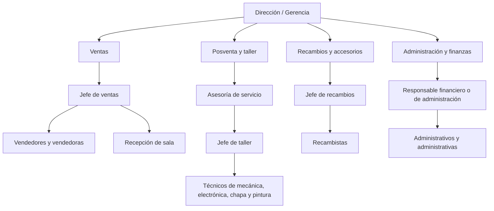

# 01 · Análisis y documentación inicial (RA1)

## 1. Sector y empresas (CE 1a, 1b)

**Sector.** Distribución y venta de vehículos nuevos y de ocasión (concesionarios y canales digitales) y servicios asociados de posventa. El informe conjunto de Faconauto y ASTAVE define a los concesionarios como pequeñas y medianas empresas, en su mayoría de carácter familiar, que se dedican a la distribución, venta y servicio posventa de automóviles de un fabricante o importador como empresarios independientes, en su propio nombre y bajo su responsabilidad (Informe de situación de los concesionarios de automoción, Faconauto/ASTAVE, con datos de cierre de 2015; sólo se usa de él la definición y la estructura de puestos, no sus cifras; consultado el 2026-11-13). A ese canal tradicional se han añadido los intermediarios digitales (portales de anuncios, marketplaces y proveedores de software y de visualización 3D).

**Clasificación de empresas del sector (7).** Todas consultadas el 2026-11-13.

| Empresa | Tipo organizativo | Producto o servicio que ofrece | Fuente (documento o página) | Tipo de fuente | Enlace y fecha de acceso | Estado (`leído` / `sin leer`) |
|---|---|---|---|---|---|---|
| coches.net (Adevinta Motor S.L.U.) | Portal de anuncios (intermediario digital, B2C y B2B) | Publicación y búsqueda de anuncios de vehículos, fichas y clasificación de resultados de búsqueda | Condiciones de uso del portal | Web oficial | https://www.coches.net/condiciones-de-uso/ (2026-11-13) | `leído` |
| AutoScout24 (Sumauto S.L.) | Portal de anuncios internacional | Publicación gratuita de anuncios de particulares y profesionales, con servicios opcionales de pago | Página «Vende tu coche» | Web oficial | https://www.autoscout24.es/vender-coche/ (2026-11-13) | `leído` |
| Wallapop | Marketplace generalista de persona a persona (app y web) | Anuncios de la categoría Motor de particulares, mensajería con el anunciante y servicios opcionales de pago (Protección Mecánica) | Guía de compra de segunda mano y página de la Protección Mecánica | Web oficial (blog y centro de ayuda) | https://about.wallapop.com/los-3-aspectos-a-revisar-antes-de-comprar-un-coche-de-segunda-mano-segun-wallapop · https://ayuda.wallapop.com/hc/es-es/articles/48825530260753-Protecci%C3%B3n-Mec%C3%A1nica-para-venta-de-coches-de-particulares (2026-11-13) | `leído` |
| CUPRA (fabricante) con MHP como consultora tecnológica | Fabricante de automóviles con configurador digital propio | Configurador de vehículo en 3D en la nube; MHP asesora, desarrolla y opera la plataforma 3D | Nota de prensa de MHP | Nota de prensa | https://www.mhp.com/en/insights/newsroom/news-detail/view/digital-vehicle-selection-at-cupra-with-just-one-click (2026-11-13) | `leído` |
| CloudPano | Proveedor de software en la nube (SaaS) de visualización | Recorridos 360º y giros de vehículo para concesionarios, con planes gratuitos y de pago | Página de precios | Web oficial | https://www.cloudpano.com/learn/cloudpano-pricing (2026-11-13) | `leído` |
| Galdón Software | Proveedor de software de gestión (DMS/ERP) para el sector | ERP para concesionarios que conecta las áreas de vehículos, ventas, recambios, taller y administración | Página del ERP para concesionarios | Web oficial | https://www.galdon.com/erp-concesionarios-dms (2026-11-13) | `leído` |
| Faconauto / ASTAVE | Asociación empresarial (patronal sectorial) | Representación, informes y estudios del sector de la distribución y venta de vehículos | Informe de situación de los concesionarios de automoción, diciembre de 2015 | Informe sectorial (PDF) | http://www.astave.org/ftp/20170710015152_informe-situacio--769-n-concesionarios-automocio--769-n-diciembre-2015.pdf (2026-11-13) | `leído` |

**Pendiente de comprobar (antes de H1):** falta añadir a la tabla al menos un **concesionario online de ocasión** (competidor directo del proyecto) y comprobar en su web oficial si ofrece vistas 360º o 3D. Candidatos a revisar, sin verificar todavía: Flexicar, Clicars, AutoHero.

**Empresa tipo: concesionario multimarca con venta de vehículos de ocasión y posventa.**

El organigrama es una simplificación: en un concesionario pequeño varios puestos pueden recaer en la misma persona. Funciones de cada departamento, según las áreas de trabajo que describe el software de gestión para concesionarios de Galdón (2026-11-13) y los puestos que recoge el informe de Faconauto/ASTAVE (2026-11-13):

- **Dirección / Gerencia:** estrategia, resultados por sede y por área, y relación con los fabricantes o proveedores.
- **Ventas:** captación y atención en sala (recepción), prospección y cierre de la venta de vehículos nuevos y de ocasión, y control del estado de cada operación (depósitos, financiación, margen y comisiones).
- **Posventa y taller:** recepción de vehículos, asesoría al cliente sobre el trabajo a realizar, planificación y ejecución de las reparaciones (mecánica, electrónica, chapa y pintura) y seguimiento de los partes de trabajo.
- **Recambios y accesorios:** stock y catálogo de recambios, reservas y almacén, vinculados a los trabajos de taller.
- **Administración y finanzas:** contabilidad, facturación (incluido el control del régimen de bienes usados cuando corresponde), nóminas y control económico.

Las fuentes consultadas (un informe de 2015 y la web de un proveedor de software de gestión) no recogen un área de marketing digital o de tienda online dentro de la estructura. Eso no prueba que hoy no exista; es una *hipótesis, pendiente de contrastar*, que un concesionario pequeño cubre esa función de forma externa o improvisada, y es la que cubre este proyecto.

## 2. Necesidades y oportunidades (CE 1c, 1d)

**Criterio de priorización.** Prioridad alta la necesidad que aparece antes en el recorrido de compra y que sustentan más fuentes; media, la que mejora la conversión o la diferenciación; baja, la que es recomendable pero no decide la compra.

| Necesidad | Prioridad | Fuente (fecha de acceso) |
|---|---|---|
| Explorar el vehículo en detalle y de forma atractiva antes de desplazarse al concesionario | **Alta** | OCU: la revisión física y la prueba en carretera son un paso previo a la compra (https://www.ocu.org/coches/coches/informe/comprar-coche-segunda-mano, 2026-11-13); inferencia propia: hoy ese paso obliga a desplazarse. *Limitación:* un modelo 3D no refleja el estado real de un coche de ocasión concreto; el showroom sirve para preseleccionar, no para sustituir la revisión física. |
| Filtrar y localizar un vehículo por criterios concretos (marca, modelo, precio, año, kilometraje, combustible) | **Alta** | Las condiciones de uso de coches.net incluyen la sección «Principales parámetros de clasificación de los resultados de búsquedas y sistemas de recomendación» (https://www.coches.net/condiciones-de-uso/, 2026-11-13) · Faconauto: 1.640.051 vehículos de ocasión vendidos en nueve meses (mismo enlace de la fila anterior, 2026-11-13) |
| Disponer de información técnica y de precio fiable para negociar | **Media** | OCU recomienda contrastar los precios en guías de valores y solicitar el contrato de compraventa propuesto por Ganvam y validado por el Instituto Nacional de Consumo (https://www.ocu.org/coches/coches/informe/comprar-coche-segunda-mano, 2026-11-13) |
| Conocer el estado real y el equipamiento del vehículo concreto | **Media** | OCU (mismo enlace): recomienda contratar una revisión profesional y revisar la documentación; *pendiente de citar el apartado exacto* |
| Diferenciarse de la oferta masiva de anuncios genéricos | **Media** | Wallapop (cifras declaradas por la propia empresa en una nota de prensa): más de 5 millones de coches publicados y cerca de 30 millones de búsquedas mensuales en la categoría Motor (https://about.wallapop.com/los-3-aspectos-a-revisar-antes-de-comprar-un-coche-de-segunda-mano-segun-wallapop, 2026-11-13) |

**Oportunidad de negocio con datos cuantitativos.**

- En 2025 se vendieron en España **2.218.913 turismos de ocasión**, un **4,2 %** más que en 2024; se vendieron **1,9 turismos de ocasión por cada turismo nuevo** y las operaciones con vehículos de más de 10 años concentraron el **57,3 %** del mercado (Faconauto y GANVAM, nota del 08-01-2026, https://www.faconauto.com/notas-de-prensa/el-mercado-de-turismos-de-segunda-mano-cumple-las-previsiones-y-cierra-2025-superando-los-22-millones-de-unidades, 2026-11-13).
- En los nueve primeros meses de 2026 se vendieron **1.640.051 turismos y todoterrenos de ocasión**, un **2,6 %** más que en el mismo periodo de 2025, con **1,8 vehículos de ocasión por cada nuevo**, un **41,6 %** de las ventas con más de 15 años, antigüedad media de 11,4 años y ventas de turismos eléctricos puros de ocasión **un 39,8 %** superiores (27.920 unidades) (Faconauto y GANVAM, nota del 06-10-2026, https://www.faconauto.com/notas-de-prensa/los-turismos-de-ocasion-superan-16-millones-de-unidades-hasta-septiembre-un-26-mas, 2026-11-13).
- La demanda digital parece alta, según las cifras que declara la propia Wallapop (fuente interesada, no auditada): **más de 5 millones de coches publicados**, **cerca de 30 millones de búsquedas mensuales** en su categoría de Motor y **más de 21 millones de usuarios** (nota de prensa publicada el 18-06-2026, https://about.wallapop.com/los-3-aspectos-a-revisar-antes-de-comprar-un-coche-de-segunda-mano-segun-wallapop, 2026-11-13).

**Lectura.** El volumen de vehículos de ocasión indica un mercado grande y con mucha demanda de información previa a la compra, y hay mercado digital consolidado (estos datos describen el mercado y no prueban por sí solos la necesidad de visualización 3D: queda como hipótesis a contrastar); pero la competencia es muy fuerte (Wallapop supera los cinco millones de anuncios), por lo que la oportunidad no está en vender más anuncios, sino en diferenciar la presentación del catálogo de un concesionario pequeño con una experiencia 3D que los anuncios con fotografías planas no dan.

## 3. Tipo de proyecto elegido (CE 1e)

**Tipo de proyecto: desarrollo de una aplicación web a medida** (proyecto de desarrollo de software), compuesta por un catálogo con servidor Java 21 y Spring Boot, base de datos SQL y un frontend de HTML5, CSS3 y JavaScript ES6+ con three.js para el showroom 3D.

Frente a otras alternativas:

- **Contratar una solución existente** (por ejemplo, los tours 360º de CloudPano, desde 27 $/mes): resuelve la visualización, pero hay coste recurrente, hay que fotografiar cada vehículo y no controlamos ni el catálogo ni los filtros; además no sirve para el objetivo académico de desarrollar el software (fuente: https://www.cloudpano.com/learn/cloudpano-pricing, 2026-11-13).
- **Publicar en un portal de anuncios** (coches.net, AutoScout24, Wallapop): llega a millones de usuarios, pero la experiencia queda reducida a fotografías planas y no permite la vista 3D ni la personalización de color (https://www.coches.net/condiciones-de-uso/ y https://about.wallapop.com/los-3-aspectos-a-revisar-antes-de-comprar-un-coche-de-segunda-mano-segun-wallapop, 2026-11-13).
- **Adaptar una plantilla o un CMS**: más rápido, pero no se ajusta al stack del ciclo (Java 21, Spring Boot, SQL). Es una restricción **académica** (el proyecto debe integrar módulos de 2.º) más que técnica; la comparación técnica se hará en el SOTA (apartado 4, H2).
- **Reutilizar three.js como base**: ya se hace (es la tecnología elegida), pero three.js es sólo una biblioteca de gráficos 3D; el catálogo, la API y la persistencia hay que desarrollarlos (https://threejs.org/examples/webgl_materials_car.html, 2026-11-13).
- **Usar un componente 3D ya hecho** (por ejemplo `<model-viewer>` de Google o un embed de Sketchfab): reduciría el esfuerzo del visor, pero puede limitar el control de cámara, las transiciones y los materiales; **pendiente de comprobar y comparar** en el SOTA (apartado 4, H2).

Se elige, por tanto, el desarrollo propio: es el único que permite integrar catálogo, fichas, favoritos, comparación, formulario y showroom 3D en un mismo producto, con alcance acotado y sin coste de licencias de software.

**Alcance del catálogo (decisión a confirmar con el tutor).** El catálogo incluye vehículos nuevos, km 0 y de ocasión, con un campo «estado». La personalización de color y llantas solo se ofrece en nuevos y km 0, porque un coche de ocasión no se puede repintar; en los de ocasión el showroom se complementa con puntos de información sobre el estado real y con fotografías reales.

## 4. Requisitos y restricciones (CE 1f)

Requisitos tomados de [`01b-sota.md`](01b-sota.md) y del proyecto descrito en [`00-documentoInicio.md`](00-documentoInicio.md) y en la propuesta (PDF). Prioridad: **M** = imprescindible para el MVP; **S** = deseable; **C** = si hay tiempo.

| ID | Requisito | Tipo | Prior. | Cómo se verifica |
|---|---|---|---|---|
| RF-01 | Listar el catálogo con filtros por marca, modelo, precio, año, kilometraje, combustible y estado (nuevo, km 0, ocasión) | funcional | M | Prueba funcional: aplicar cada filtro sobre datos de prueba y comprobar que solo aparecen vehículos que lo cumplen |
| RF-02 | Mostrar la ficha técnica de cada vehículo (datos, precio y fotografías) | funcional | M | Abrir la ficha desde la lista y comprobar campo por campo que coincide con la base de datos |
| RF-03 | Mostrar el showroom 3D con vistas predefinidas frontal, lateral, trasera y superior, vista libre (girar, acercar y alejar) y vista rotativa automática sobre la plataforma | funcional | M | Prueba en navegador: seleccionar cada vista y comprobar la posición de la cámara; en la rotativa, que el modelo gira solo |
| RF-04 | Cambiar el color de la carrocería en el showroom (vehículos nuevos y km 0 con modelo compatible) y ver el cambio en el modelo 3D | funcional | M | Elegir cada color disponible y comprobar visualmente el cambio del material de la carrocería |
| RF-05 | Marcar vehículos como favoritos y compararlos en una tabla con los mismos campos | funcional | S | Añadir dos vehículos y comprobar que aparecen en la comparación con todos los campos |
| RF-06 | Enviar una solicitud de información desde un formulario asociada al vehículo consultado | funcional | M | Enviar el formulario con datos ficticios y comprobar que la petición llega al servidor y se almacena |
| RF-07 | Exponer los datos del catálogo y de la ficha mediante una API REST que devuelve JSON | funcional | M | cURL o Postman: los endpoints del catálogo responden 200 con JSON válido |
| RF-08 | Ordenar el catálogo (al menos por precio, año y kilometraje) | funcional | S | Ordenar sobre datos de prueba y comprobar el orden ascendente y descendente |
| RF-09 | Página principal con vehículos destacados y accesos al catálogo y al contacto | funcional | S | Comprobar que los destacados salen de la base de datos y los enlaces funcionan |
| RF-10 | Transición de cámara animada al abrir el showroom desde la ficha y al cambiar de vista | funcional | M | Prueba en navegador: la cámara se desplaza de forma continua (sin salto) entre vistas |
| RF-11 | Puntos de información sobre partes del vehículo (equipamiento y, en ocasión, estado real) | funcional | C | Pulsar cada punto y comprobar que muestra su texto y que la cámara se coloca en la zona |
| RNF-01 | El primer contenido relevante (LCP) de la página del catálogo se muestra en 2,5 s o menos en el percentil 75 de las cargas | no funcional | M | Auditoría con Lighthouse o PageSpeed Insights. Umbral de los Core Web Vitals (https://web.dev/articles/vitals, 2026-11-13) |
| RNF-02 | La interfaz es usable sin scroll horizontal desde 320 px de ancho | no funcional | M | Modo responsive de DevTools a 320, 375, 768 y 1440 px |
| RNF-03 | El showroom se mueve con fluidez (objetivo: 30 fotogramas por segundo o más en un ordenador de gama media) | no funcional | M | Pendiente: decidir herramienta y equipo de medición (antes de H3) |
| RNF-04 | La aplicación no almacena datos personales reales; el formulario muestra un aviso de demo («no introduzcas datos reales») | no funcional | M | Revisar el esquema de la base de datos (sin campos identificativos reales) y comprobar que el aviso es visible |
| RNF-05 | Peso y carga de los modelos 3D: objetivo provisional de ≤ 10 MB por modelo (formato GLB, comprimido si hace falta) y carga inicial del showroom en un tiempo razonable | no funcional | M | Medir peso del archivo y tiempo de carga con la red limitada de DevTools; el valor se ajusta tras la prueba de viabilidad 3D |
| RNF-06 | Accesibilidad: objetivo WCAG 2.1 nivel AA en catálogo, fichas y formulario; el showroom ofrece una alternativa con fotografías | no funcional | S | Lighthouse (accesibilidad) y revisión manual con teclado |
| RNF-07 | Si el navegador no soporta WebGL, la ficha sigue mostrando fotografías y un mensaje claro en lugar del showroom | no funcional | S | Desactivar WebGL en el navegador y comprobar el mensaje y las fotografías |
| RNF-08 | Seguridad básica: validación en servidor del formulario y de los parámetros de filtro (consultas parametrizadas), CORS restringido y límite de envíos del formulario | no funcional | S | Pruebas con entradas inválidas y con intentos de inyección sobre datos de prueba |
| REST-01 | Plazo: H1 el 26-11-2026, H2 el 21-01-2027 y primera versión funcional antes del 31-03-2027 | restricción | M | Fechas de entrega y commits en el repositorio |
| REST-02 | Tecnologías de partida (restricción académica del ciclo): HTML5, CSS3 y JavaScript ES6+ con three.js; Java 21 y Spring Boot; base de datos SQL (MySQL o PostgreSQL); Git y GitHub | restricción | M | Revisión del repositorio: archivos de proyecto y dependencias (pom.xml o build.gradle) |
| REST-03 | Cumplir la LSSI-CE (aviso legal, política de cookies y comunicaciones comerciales), el RGPD y la LOPDGDD, sin datos personales reales | restricción | M | Revisión del aviso legal, la política de cookies, el formulario y que no se ceden datos a terceros |
| REST-04 | Coste económico 0 €: solo herramientas gratuitas o de código abierto (three.js, licencia MIT) | restricción | M | Lista de dependencias sin licencias de pago |
| REST-05 | Alcance: fuera de la primera versión quedan la vista inferior, el interior del habitáculo y el cambio de llantas | restricción | M | Revisión funcional antes de la entrega: esas tres funciones no deben estar en el MVP |
| REST-06 | Modelos 3D en formato glTF/GLB con licencia que permita su uso y la modificación de materiales (por ejemplo CC0 o CC-BY con atribución); se anotan autor, licencia, enlace y peso de cada uno | restricción | M | Tabla de modelos en el repositorio y revisión de cada licencia |

### Matriz de trazabilidad

Los casos de uso y los endpoints son una **propuesta** que se confirmará en la fase de diseño.

| Objetivo | Requisito | Caso de uso | Pantalla o endpoint | Prueba o indicador |
|---|---|---|---|---|
| OBJ-01 Consultar y filtrar el catálogo | RF-01 | CU-01 Buscar y filtrar vehículos | Catálogo · `GET /api/vehiculos` | Ver verificación de RF-01 |
| OBJ-01 Consultar y filtrar el catálogo | RF-02 | CU-02 Ver ficha de un vehículo | Ficha · `GET /api/vehiculos/{id}` | Ver verificación de RF-02 |
| OBJ-01 Consultar y filtrar el catálogo | RF-07 | CU-01 y CU-02 | API REST | Ver verificación de RF-07 |
| OBJ-01 Consultar y filtrar el catálogo | RF-08 | CU-01 Buscar y filtrar vehículos | Catálogo · parámetros de orden en `GET /api/vehiculos` | Ver verificación de RF-08 |
| OBJ-01 Consultar y filtrar el catálogo | RF-09 | CU-07 Ver vehículos destacados | Página principal | Ver verificación de RF-09 |
| OBJ-02 Explorar el vehículo en 3D | RF-03 | CU-03 Explorar en el showroom | Showroom | Ver verificación de RF-03 |
| OBJ-02 Explorar el vehículo en 3D | RF-04 | CU-04 Cambiar el color | Showroom | Ver verificación de RF-04 |
| OBJ-02 Explorar el vehículo en 3D | RF-10 | CU-03 Explorar en el showroom | Showroom | Ver verificación de RF-10 |
| OBJ-02 Explorar el vehículo en 3D | RF-11 | CU-08 Consultar puntos de información | Showroom | Ver verificación de RF-11 |
| OBJ-03 Guardar y comparar vehículos | RF-05 | CU-05 Gestionar favoritos y comparar | Favoritos y comparador | Ver verificación de RF-05 |
| OBJ-04 Contactar con el concesionario | RF-06 | CU-06 Solicitar información | Formulario · `POST /api/solicitudes` | Ver verificación de RF-06 |
| OBJ-05 Garantizar rendimiento, usabilidad y privacidad | RNF-01 a RNF-08 | Transversal | Toda la aplicación | Ver verificación de cada RNF |
| OBJ-06 Cumplir plazo, tecnología, normativa y alcance | REST-01 a REST-06 | Transversal | Repositorio y documentación | Ver verificación de cada REST |

## 5. Obligaciones fiscales, laborales y de prevención (CE 1g)

**Obligaciones fiscales**

- **IVA y régimen de bienes usados (REBU).** Ley 37/1992, de 28 de diciembre, del Impuesto sobre el Valor Añadido (BOE-A-1992-28740), arts. 135 a 139, y desarrollo en los arts. 50 y 51 del Real Decreto 1624/1992; obligaciones de facturación en el Real Decreto 1619/2012. La ficha oficial de la Agencia Tributaria «¿A quién se aplica el REBU?» define como revendedor a «quien realice de forma habitual entregas de bienes usados, objetos de arte, antigüedades y objetos de colección para su reventa» y remite a esa normativa (https://sede.agenciatributaria.gob.es/Sede/iva/regimenes-tributacion-iva/regimen-especial-bienes-usados/quien-se-aplica-rebu.html, 2026-11-13). El art. 135, apartado Tres, de la Ley 37/1992 excluye del régimen las entregas de los medios de transporte **nuevos** del art. 13.2 en las condiciones de los arts. 25.1 a 25.3; por tanto, un vehículo de ocasión sí puede acogerse a este régimen.
  *Aplicación al proyecto:* es un encargo simulado: no se emite factura ni se realiza ninguna operación sujeta; la regla queda documentada en la ficha de producto del concesionario tipo.

**Obligaciones laborales**

- **Contrato de trabajo.** Real Decreto Legislativo 2/2015, de 23 de octubre, por el que se aprueba el texto refundido del Estatuto de los Trabajadores (BOE-A-2015-11430), art. 8: el contrato puede celebrarse por escrito o de palabra, pero deberán constar por escrito los supuestos que enumera el apartado 2, entre ellos los contratos por tiempo determinado con duración superior a cuatro semanas.
- **Convenio colectivo aplicable a los concesionarios de vehículos:** pendiente de comprobar. En la sesión del 2026-11-13 no se localizó en el BOE un convenio colectivo estatal de concesionarios de vehículos a motor, así que no se cita ninguna norma colectiva para no inventarla. Pista para la búsqueda (sin verificar): podría existir un convenio autonómico o provincial, por ejemplo del comercio del metal; comprobarlo en el BOPA o en el registro de convenios REGCON.

**Prevención de riesgos laborales (PRL)**

- **Ley 31/1995, de 8 de noviembre, de prevención de riesgos laborales**, art. 14: el empresario debe garantizar la seguridad y la salud de los trabajadores en todos los trabajos, evaluar los riesgos, planificar la actividad preventiva e informar y formar a los trabajadores.
- **Real Decreto 488/1997, de 4 de abril** (BOE-A-1997-8671), sobre obligaciones mínimas en materia de seguridad y salud en el trabajo con equipos que incluyen pantallas de visualización, y su Anexo VI: condiciones mínimas del puesto de trabajo con pantalla (mobiliario, iluminación, pausas), aplicable al puesto de desarrollo de este proyecto.

**Protección de datos y comunicaciones electrónicas**

- **RGPD:** Reglamento (UE) 2016/679, art. 5 (principios de licitud, lealtad y transparencia, limitación de la finalidad, minimización de datos, exactitud, limitación del plazo de conservación e integridad y confidencialidad). Texto consultado en el DOUE publicado en el BOE (DOUE-L-2016-80807, https://www.boe.es/doue/2016/119/L00001-00088.pdf), el 2026-11-13.
- **LOPDGDD:** Ley Orgánica 3/2018, de 5 de diciembre (BOE-A-2018-16673), arts. 6 y 7, sobre condiciones del consentimiento.
- **LSSI-CE:** Ley 34/2002, de 11 de julio, de servicios de la sociedad de la información (BOE-A-2002-13758), art. 21 (prohibición de enviar comunicaciones publicitarias no solicitadas o no autorizadas por correo electrónico) y art. 22 (los dispositivos de almacenamiento y recuperación de datos en el equipo del destinatario requieren su consentimiento previo tras una información clara y completa).
- **RGPD, art. 13** (información que debe darse a quien facilita sus datos) y **LSSI-CE, art. 10** (información general del prestador del servicio: aviso legal). *Pendiente de comprobar el texto exacto en el BOE antes de citarlos como definitivos.*
- *Aplicación al proyecto:* no se recogen datos personales reales; el formulario de contacto es una simulación con datos ficticios y, si la demo se publica, mostrará un aviso («no introduzcas datos reales»), un aviso legal y una política de privacidad mínimos; si se instalan cookies no estrictamente necesarias, deberá existir política de cookies y consentimiento previo.

**Consumo, propiedad intelectual y marcas** *(pendiente de comprobar en el BOE antes de H2)*

- **Consumidores:** el texto refundido de la Ley General para la Defensa de los Consumidores y Usuarios (Real Decreto Legislativo 1/2007) regula la información de precios y de la oferta comercial; localizar los artículos aplicables a mostrar el precio final en el catálogo.
- **Propiedad intelectual y marcas:** los modelos 3D y las fotografías de terceros tienen licencia propia (texto refundido de la Ley de Propiedad Intelectual, Real Decreto Legislativo 1/1996), y los logotipos y diseños de marcas de automóviles pueden estar protegidos (Ley 17/2001, de Marcas). *Aplicación al proyecto:* se usarán solo modelos con licencia compatible (REST-06) y se evitarán los que reproduzcan logotipos de marcas reales.

## 6. Ayudas y subvenciones (CE 1h)

Ayudas comprobadas el 2026-11-13:

| Ayuda | Estado el 2026-11-13 | Requisitos y condiciones | Plazo | Fuente |
|---|---|---|---|---|
| **Kit Digital** (programa nacional gestionado por Red.es) | **Cerrada** | Ayudas a pymes, microempresas y autónomos para contratar soluciones de digitalización; el programa acumuló más de 848.000 ayudas y más de 3.400 millones de euros en tres años | Cerrado oficialmente el 31-10-2025, con el cierre de las dos últimas convocatorias | https://www.red.es/es/actualidad/noticias/kit-digital-cierra-las-dos-ultimas-convocatorias-que-quedaban-abiertas-tras-mas (2026-11-13) |
| **Programa Pyme Digital 2026** (Cámara Oficial de Comercio, Industria, Servicios y Navegación de Avilés, FEDER/POPe) — Asturias | **Cerrada** | Pymes dadas de alta en el IAE de la demarcación de Avilés; ayuda del 60 %, con ayuda máxima de 4.494,00 € sobre un presupuesto elegible máximo de 7.490,00 € (7.000 € de coste directo + 490 € de costes indirectos) | Abrió a las 09:00 h tras 5 días hábiles desde la publicación y cerró a las 14:00 h del 16-10-2026 | Extracto de la convocatoria, BOPA núm. 174, de 9-ix-2026, cód. 2026-07348, BDNS 927280 (PDF consultado el 2026-11-13) |
| **Cheques de innovación y desarrollo empresarial 2026** (Agencia SEKUENS, Principado de Asturias) | **Cerrada** | Convocatoria de subvenciones a empresas del Principado en régimen de concurrencia competitiva, dotada con 500.000,00 € | Hasta las 14:00 h del 30-04-2026 | Extracto de la convocatoria, BOPA núm. 58, de 25-iii-2026, cód. 2026-02393 (PDF consultado el 2026-11-13) |
| **ICO Crecimiento** (Instituto de Crédito Oficial) — ayuda vigente que se propone | **Abierta** | Préstamo directo del ICO a empresas para financiar inversiones; valor nominal mínimo de 50.000 €, sin importe máximo, y el préstamo no puede superar el 80 % de la inversión; tipo de interés general Euribor a un año (con límite inferior 0 %) + 1,75 % | Solicitudes hasta el 31-12-2027 | https://www.ico.es/web/ico-online/crecimiento-condiciones (2026-11-13) |

**Propuesta y límites.** La única ayuda nacional vigente que he podido comprobar hoy es la línea ICO Crecimiento, y hay que decir claramente dos cosas: es un **préstamo, no una subvención**, y su importe mínimo de 50.000 € la hace **inadecuada para este proyecto académico**, que se ejecuta con coste 0 €; se propone como referencia de financiación pública disponible para la empresa tipo si decidiera invertir en digitalización. En Asturias no he encontrado ninguna convocatoria de digitalización abierta el 2026-11-13: las tres líneas comprobadas están cerradas. **Pendiente de comprobar** antes de H2: si el Principado abre una nueva convocatoria de digitalización, si Red.es reabre un programa equivalente a Kit Digital, y qué convocatoria equivalente tiene la Cámara de Comercio de la demarcación de la empresa tipo (la de Avilés solo cubre la suya), además de otras líneas de SEKUENS.

## 7. Guion de trabajo (CE 1i)

Fases, hitos y responsables. Los responsables son el alumno (Saúl), que ejecuta todas las fases, y el tutor, que revisa y aprueba los hitos; no hay más miembros en el equipo (encargo simulado). Las fechas marcadas como **propuesta** son mías y se confirmarán en el tablero.

| Fase | Contenido | Fechas | Responsable |
|---|---|---|---|
| F0 · Inicio | Sesión de inicio, propuesta y aprobación del proyecto | Inicio el 06-11-2026; aprobación el 12-11-2026 (confirmar que se ha producido) | Alumno con el tutor |
| F1 · Investigación | Preguntas de búsqueda y tabla de soluciones del SOTA (apartados 1 y 2) hasta el 18-11-2026; hueco y diferenciación (apartado 5) hasta el 25-11-2026 | 06-11-2026 → 25-11-2026 | Alumno |
| F2 · Entrega H1 | `01-analisis.md` completo y `01b-sota.md` en versión breve (apartados 1, 2 y 5) | **26-11-2026** | Alumno, revisión del tutor |
| F3 · Prueba de viabilidad 3D | Cargar un modelo GLB, cambiar un material, mover la cámara con una transición, medir peso y fotogramas; decidir los modelos y cerrar el alcance 3D | 26-11-2026 → 18-12-2026 (**propuesta**) | Alumno |
| F4 · Diseño y servidor | Modelo de datos, base de datos SQL y API REST con Java 21 y Spring Boot | 11-01-2027 → 21-01-2027 y siguientes (**propuesta**; fechas finales pendientes en el tablero) | Alumno |
| F5 · Entrega H2 | SOTA completo (4-6 páginas) y análisis actualizado | **21-01-2027** | Alumno, revisión del tutor |
| F6 · Frontend y showroom 3D | Catálogo, fichas, favoritos, comparación, formulario y escena de three.js con vistas, rotación, color y transiciones | 22-01-2027 → 12-03-2027 (**propuesta**) | Alumno |
| F7 · Pruebas y despliegue | Pruebas de los requisitos, ajuste de rendimiento y accesibilidad, y despliegue básico de la demo | 13-03-2027 → 29-03-2027 (**propuesta**; incluye margen para imprevistos) | Alumno |
| F8 · MVP | Primera versión funcional en el repositorio | **Antes del 31-03-2027** | Alumno, revisión del tutor |

Origen de las fechas fijas: [`00-documentoInicio.md`](00-documentoInicio.md) (sesión de inicio, aprobación y plazo del MVP) y [`01b-sota.md`](01b-sota.md) (calendario de H1 y H2). La documentación final y la defensa quedan **pendientes de fechas** hasta que el tutor las comunique.

**Repositorio y tablero.** El repositorio es https://github.com/Saulpa/proyecto-final-daw-saul. El tablero de GitHub Projects está **pendiente de crear**; se usará para seguir las tareas de F3 a F8.

## 8. Glosario

| Término | Definición | Sinónimos que NO uso |
|---|---|---|
| REBU | Régimen Especial de Bienes Usados: régimen voluntario del IVA en el que el impuesto se calcula sobre el margen de reventa cuando el vendedor es revendedor (Ley 37/1992, arts. 135-139) | «IVA de segunda mano», «régimen del margen» |
| Concesionario multimarca | Empresa que vende y da servicio posventa de vehículos de distintos fabricantes bajo su propia responsabilidad y riesgo | «concesionario oficial», «concesionario de red» (usos para fabricantes con red asignada) |
| Posventa | Servicios posteriores a la venta: taller, mantenimiento, recambios y asesoría al cliente | «postventa», «after sales» |
| Showroom 3D | Escena interactiva en el navegador donde el vehículo se ve desde varias cámaras, se gira libremente y se personaliza | «visor 3D», «galería 3D», «taller virtual» |
| glTF / GLB | Formato de intercambio de modelos 3D para la web; `.glb` es la variante binaria en un solo archivo (Khronos, glTF 2.0 = ISO/IEC 12113:2022) | «objeto 3D», «modelo 3D» sin especificar formato |
| MVP | Producto viable mínimo: primera versión funcional que reúne los requisitos esenciales | «versión final», «prototipo», «beta» |
| Vista inferior | Perspectiva de cámara que muestra los bajos del vehículo, si el modelo tiene el detalle necesario | «vista de suelo», «vista de abajo» |
| Punto de información (*hotspot*) | Marca sobre una parte del vehículo en el showroom que muestra un texto y coloca la cámara en esa zona | «etiqueta», «pin» |
| Prueba de viabilidad 3D (*spike*) | Prueba técnica corta para comprobar la viabilidad del showroom antes de construir el resto | «prototipo» |

---

## Criterios de evaluación de este documento (RA1, texto literal)

- **1a)** Se han clasificado las empresas del sector por sus características organizativas y el tipo de producto o servicio que ofrecen.
- **1b)** Se han caracterizado las empresas tipo indicando la estructura organizativa y las funciones de cada departamento.
- **1c)** Se han identificado las necesidades más demandadas a las empresas.
- **1d)** Se han valorado las oportunidades de negocio previsibles en el sector.
- **1e)** Se ha identificado el tipo de proyecto requerido para dar respuesta a las demandas previstas.
- **1f)** Se han determinado las características específicas requeridas al proyecto.
- **1g)** Se han determinado las obligaciones fiscales, laborales y de prevención de riesgos y sus condiciones de aplicación.
- **1h)** Se han identificado posibles ayudas o subvenciones para la incorporación de nuevas tecnologías de producción o de servicio que se proponen.
- **1i)** Se ha elaborado el guión de trabajo que se va a seguir para la elaboración del proyecto.
